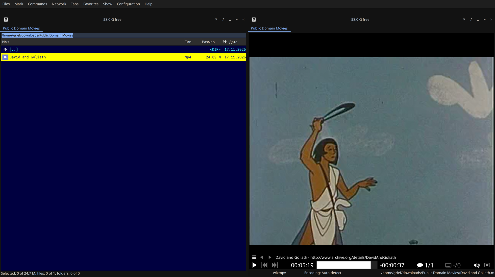

# double-commander-wlx-mpv

A lister (WLX) plugin for [Double Commander](https://doublecmd.sourceforge.io/) that plays audio and video
right inside Quick View (`Ctrl+Q`), powered by [libmpv](https://mpv.io/).

Unlike plugins that embed an mpv window through `--wid`, this one renders frames off-screen and paints them
into a regular Qt widget, so it works on Wayland as well as on X11.



## Features

- Audio and video playback in Quick View with the standard mpv on-screen controller (seek bar, play/pause, volume).
- For audio files: file name, codec, sample rate, channels, duration and tags are shown on screen.
- Rendering on the GPU through OpenGL in a dedicated thread, with automatic fallback to software rendering.
- Hardware video decoding (`hwdec=auto-safe`).
- HiDPI aware; rendering does not block the UI thread.
- Playback stops at the end and rewinds to the start, so Play replays the file.

## Requirements

- Double Commander built with Qt5 (`doublecmd-qt`).
- `libmpv` at runtime (`libmpv.so.2`, loaded dynamically).
- Build dependencies: a C++17 compiler, `make`, `pkg-config`, Qt5 and libmpv headers.

On Debian/Ubuntu:

```sh
sudo apt install libmpv2 qtbase5-dev libmpv-dev
```

## Build and install

```sh
make install
```

This builds `wlxmpv.wlx` and copies it to `~/.config/doublecmd/plugins/wlx/wlxmpv/`.

Then register it in Double Commander: *Configuration → Options → Plugins → Plugins WLX → Add* and pick
`~/.config/doublecmd/plugins/wlx/wlxmpv/wlxmpv.wlx`. The detect string is provided by the plugin and covers common
audio and video extensions (WAV, FLAC, MP3, OGG, OPUS, MP4, MKV, WEBM and others); it can be edited in the same
dialog.

## Controls

- Mouse over the on-screen controller works as in mpv.
- Right click toggles pause.
- Mouse wheel changes volume.

## How it works

The plugin loads libmpv with `dlopen(RTLD_DEEPBIND)` to keep mpv's Lua separate from the one Double Commander may
load. mpv uses the render API (`vo=libmpv`): a background thread renders each frame into an off-screen OpenGL
framebuffer and reads it back, or uses mpv's software renderer when OpenGL is unavailable. The finished frame is
handed to the widget, which only draws it.

## License

[MIT](LICENSE)
